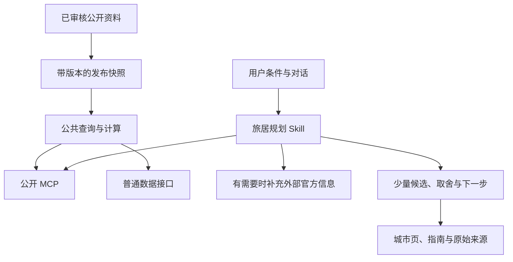

# Roamorrow 公开 MCP 与旅居规划 Skill 设计

状态：2026-10-26 用户批准开始实现，并要求逻辑轻量、少追问、少步骤。当前按轻量首版实现，与已合并的 SEO PR #38 分开交付。

## 轻量首版调整

首版只查询当前已审核快照，版本失效时明确返回错误，暂不增加R2和历史归档。直接使用官方SDK的无状态处理器，不额外引入Agents包装层。一个Skill主文件配必要参考与无依赖脚本，六种流程按需使用；不为每种流程创建独立安装包。

国家或城市背景、消费样本、工作线索和已知会议时段合并到一次主查询；比较工具也带关键明细。初步建议默认先给候选，只有会改变结论的关键歧义才补问一项。以下为完整目标设计，归档存储等后续扩展以实现记录为准。

## 建议

推荐开放一个无需登录的只读 MCP，同时提供一个总 Skill，内部按需加载六种旅居规划流程。MCP 返回可核对的数据与计算结果；Skill 处理用户条件，选择查询顺序，并解释建议成立的条件。网站继续提供人能阅读、分享和核查的城市页与指南。

目标是让用户在自己已有的工具中完成“选哪里、为什么、多少钱、工作是否合适、下一步核对什么”。本方案把中文旅居者和远程工作者作为首批对象，不从中文语言或人民币预算推断护照。

原始数据在这里指经过发布审核、保留来源与原币单位的结构化观察，不是开发数据库的整库转发。用户无需申请 Roamorrow 账号或填写服务密钥。连接客户端本身的工具授权仍由该客户端管理。

## 现有基础与适用范围

以下来自本地已审核公开种子和当前实现，不代表全球覆盖或实时供给。

| 已有资料或能力 | 当前情况 | 设计上的用途 |
| --- | --- | --- |
| 城市与地区目录 | 350 座已发布城市，258 个目录地区 | 解析地名、确定查询范围；地区数量不等于主权国家数量 |
| 城市消费观察 | 155 城有城市级样本 | 保留房型、计价单位和日期，供预算情景引用 |
| 逐月气候 | 158 城，2023–2025 年历史资料 | 按月份比较，明确不提供未来天气 |
| 位置和时区 | 342 条城市位置记录 | 会议换算前校验有效时区 |
| 工作地点地图 | 314 城有 OSM 快照 | 查工作地点线索，数量不证明营业或允许办公 |
| 运营方工位报价 | 15 条，覆盖 4 城 | 有样本时核对具体方案，不外推其他城市 |
| 停留政策 | 23 个项目，覆盖 22 个目录国家 | 按护照和政策范围返回；不裁定个人资格 |
| 产品地域名单 | 750 条，覆盖 250 个地区，真实测试数为 0 | 区分官方名单与实际账号、支付和网络可用性 |
| 已有工具实现 | 17 类查询与计算 | 复用排序、消费口径和时间计算，调整公共接口 |

已有消费样本的采样末日介于 2026-09-16 与 2026-10-14，公开种子的汇率日为 2026-10-16。接口不能把今天的发布日包装为今天核对的价格。

目前没有可靠的用户问题频次统计。下文的场景优先级来自现有产品能力、测试问句和使用路径，是待验证的产品判断。

## 比较三种做法

| 方案 | 能得到什么 | 主要代价 |
| --- | --- | --- |
| 仅开放数据 MCP | 外部工具能自行查询和组合 | 用户的预算、月份和工作条件容易遗漏；各客户端建议质量差异较大 |
| 仅发布 Skill，读取网页或普通接口 | 接入较轻，便于快速试用 | 结构化查询和来源字段容易重复实现，依赖宿主的联网能力 |
| 共用数据查询能力，提供 MCP 与总 Skill | 数据与建议流程各自维护，网站和外部客户端可复用 | 需要维护公开字段、版本和兼容性测试 |

推荐第三种。服务端不代替客户端生成整段建议，也不将所有需求交给一个不透明的“自动推荐”工具。先给出少量可组合的查询，再用明确的场景流程帮助用户完成决定。

## 产品结构



这是目标结构。现有网站的 D1 与 HTML 回退机制继续工作，不以重写网站作为发布 MCP 的前提。MCP 独立部署，代码仍放在当前仓库，复用现有数据与计算模块。

建议公开地址为 `https://mcp.roamorrow.com/mcp`，集成说明放在主站 `/nomads/developers/`。这两个地址都是拟定地址，目前未部署。独立 Worker 不绑定网站的业务数据库，不载入站内对话运行时或模型密钥。Workers 的账号级额度仍可能共享，独立部署不等于所有费用和额度都隔离。

## MCP 首版工具

首版建议 12 个工具。工具名是接口草案，中文用途用于面向用户的说明。返回结果默认精简，可按具体维度读取详情。

| 工具 | 输入与用途 | 返回结果和边界 |
| --- | --- | --- |
| `nomads_search_places` | 名称、城市或国家类型、数量 | 稳定公开 ID、名称与歧义候选；不把“便宜安静”当作地名 |
| `nomads_get_context` | 地点 ID、所需主题、可选月份与护照 | 国家或城市的背景资料包，始终含覆盖与缺项；国家最多先列 8 城 |
| `nomads_find_cities` | 国家范围、月份、气候阈值、已有排序偏好 | 候选与适配依据，说明硬条件如何处理、哪些条件缺资料 |
| `nomads_compare_cities` | 2–3 座城市、月份和比较维度 | 同口径比较、来源和缺项；签证或资料空白不产生赢家 |
| `nomads_get_costs` | 城市或国家、类别、展示币种、地域层级 | 原始观察、换算、单位与来源；国家层面先返回价格覆盖，不伪造城市报价 |
| `nomads_get_climate` | 最多 3 城、所需月份 | 历史月均温、高温和降雨；不提供夜间最低温、空气质量或天气预报 |
| `nomads_get_entry_rules` | 国家与护照代码，均须明确 | 停留政策、工作范围、适用对象及日期；其他护照无数据则明确返回 |
| `nomads_get_work_conditions` | 城市或国家、所需工作条件 | 旧网络指标、场所线索、运营方报价和服务地域名单，分别标注核验范围 |
| `nomads_get_sources` | 最多 20 个公开来源 ID | 来源网址、标题、日期、署名与已知许可；不需要依赖上一次会话 |
| `nomads_get_catalog_info` | 发布、覆盖或方法主题，可选国家 | 数据版本、覆盖、计算方法和许可说明；不返回整库 |
| `nomads_calculate_budget` | 总额、币种、天数、人数、明确的费用假设 | 余额、住宿上限、遗漏项和可携带预算快照；计算平衡不证明市场可行 |
| `nomads_convert_meeting_time` | 城市、基准时区、真实日期、最多 4 个时点 | 当地日期与时间，处理跨日及夏令时异常；不猜用户所在时区 |

`get_context` 的成本、气候和工作主题返回摘要与可继续读取的 ID，避免与专门工具重复返回全部观察。它的价值是减少建立国家背景所需的调用次数，不在服务端替用户选定城市。

未提供护照时，背景资料包只能返回政策资料的覆盖和适用对象，不能给出个人适用结论或默认套用 CN。公开地点 ID 使用与开发库解耦的稳定格式，例如 `city:chiang-mai` 和 `country:TH`；名称歧义由搜索结果确认。

`find_cities` 复用网站已公开的计算方法和出行提醒排除规则。硬条件与偏好分开，缺少气候的城市不算“已满足温度要求”，也不伪装成零分。需要探索缺资料选项时，另列条件未证实的备选。资料覆盖率与适配分分别返回，不用一个总分掩盖缺项。

普通低预算规划不按旧美元月参考值直接淘汰目的地。用户明确要求按历史总价严格筛选时，才使用单独标明口径的筛选字段；筛空只说明该历史筛选没有结果。

独立汇率换算、指南搜索和读取指南全文可在下一版增加。首版消费查询已经支持有日期的币种换算，资料包也可以返回相关指南链接。

## 怎样复用现有 17 类能力

`search_cities`、`get_city` 和 `compare_cities` 的公开数据逻辑进入共享查询模块；历史气候与消费口径沿用现有实现。`get_workspaces` 和 `get_ai_access` 的结果仍保持不同证据类型，由工作条件工具组织。

`get_coverage` 与 `get_method` 在公共接口合并为目录信息；覆盖日期改为来自真实发布清单，移除现有固定日期。`get_sources` 改为读取公共 ID，不保留“必须是本对话已读来源”的会话前提。

预算使用现有纯计算函数。`recalculate_budget` 不能原样搬出：公共服务没有“上次预算”。改为由客户端传回完整、经过校验的预算快照，或直接重传已确认假设。默认修改天数时保留原单价、一次性费用和原有分配方式；重新分配余额需要用户明确表达。

旧总价折算 `estimate_budget` 放到明确请求历史参考的兼容能力，不作为首版推荐预算入口。维护资料、部署和评测属于内部工作流程，不进入公共 MCP。

## 公共数据怎样表达

所有工具采用同一返回结构，至少包含 `data_version`、结构化结果、证据和覆盖情况。必要的局限随结果返回，不能只写在 Skill 或工具描述中。

| 信息 | 必须说明的内容 |
| --- | --- |
| 数值 | 原值、原币、单位、计价周期和地域范围 |
| 时间 | 观察期、核读日、发布日分别保存 |
| 来源 | 公开来源 ID、可访问网址及署名 |
| 派生结果 | 用了哪些观察、哪一版计算方法与汇率 |
| 资料状态 | 有记录、未采集、不适用或待核验，不用一个空值混同 |
| 可推荐性 | 已审核提醒及其范围；没有排除提醒不表示已完成安全审查 |

城市住房样本与全国居民统计分开。公斤价不直接凑成月预算，长租挂牌不自动变成短租报价。OSM 地点数量不直接证明社群活跃；产品地域名单不等于实际可用。

数据新旧按类别判断。历史气候注明观测年份；价格保留采样日期；政策保留适用范围与核读日期。沿用现有已实现的过期口径时，也应在方法说明中写清，不能把“未超过复核窗口”表述成当前事实已经验证。

每次读取固定版本。第一条资料查询返回 `data_version`，后续工具均可显式传入该版本，总 Skill 在一次推荐中固定使用它。提议保留最近 3 个版本且至少 30 天；引用版本不再可用则返回 `DATA_VERSION_UNAVAILABLE` 和最新版本，让客户端重新建立建议，不悄悄混用。

## 发布快照与稳定性

从现有已审核公开发布库生成面向查询的 JSON，不让外部请求访问开发库或实时 D1。按城市、国家和来源拆分，气候与消费样本可按需读取；小目录索引供名称解析与候选筛选。索引与分片都带版本与检查散列。

拟定的普通数据路径为 `/data/v1/releases/<data_version>/...`，当前版本由短清单指向。公开文件采用可缓存的不可变地址。普通接口与 MCP 调用相同查询模块；Skill 所在环境没有 MCP 但具备读取公开数据的能力时，可使用该路径。没有联网能力则返回可安装说明，不伪造查询结果。

当前版本的小目录可随 Worker Assets 发布；历史版本建议放在独立的公开资料 R2 存储中，由只读查询入口按固定对象名读取并缓存，避免把多版本全部塞进部署包。保留策略为至少最近 3 个版本，并保留发布后 30 天内的全部版本。R2 的开通要求与实际费用在实施时核实，不把用户免登录等同于维护者无需配置存储或基础设施永久免费。

缓存内部查询结果，不直接缓存含调用 ID 的整个 MCP 响应。缓存键包含数据版本、规范化参数、使用的汇率日和方法版本。预算情景与用户上下文不进入共享响应缓存。

默认不进行服务端实时网页检索，也不调用付费模型。数据更新是独立的审核发布流程。外部最新报价或官方政策由 Skill 所在客户端在需要时补查，并保留另一组来源与日期；如果宿主缺少检索能力，就明确列为待核对事项。

目前 2,084 条源记录中有 1,749 条没有填写许可字段。发布前需逐类确认允许再分发的字段，代码的 MIT 许可不能直接替代数据来源的许可核对。许可状态未明确的字段先标记 `license_review_pending`，相关来源提供已有公开链接与必要元数据，不直接批量转发其全文或图片。发布清单分别记录可公开观察和只提供引用的材料；本设计不宣布这些空许可字段均不可使用或均可自由再分发。

## 免登录如何限制使用

限制针对资源消耗，不建立个人账号体系。以下数值是首轮配置建议，需要兼容性和负载测试后调整。

| 限制 | 首轮建议 |
| --- | --- |
| 查询请求 | 请求体最多 16 KiB；不接受自由 SQL、任意网址抓取或任意字段访问 |
| 单次结果 | 搜索默认 10 条、最多 20；消费默认 20 条、最多 50；来源最多 20 个 |
| 计算规模 | 对比最多 3 城；月份最多 12；预算费用最多 12 项；会议时点最多 4 个 |
| 返回体积 | 默认目标 16 KiB，硬上限 64 KiB，超出用分页或读取详情 |
| 网络级短期限流 | 暂定每 10 秒 20 次、每分钟 120 次，作为宽松防滥用阈值 |
| 服务保护 | 按工具成本分级，提供全局只读维护开关和错误率熔断 |

网络级阈值不能声称“每个用户的额度”。共享办公、企业代理或托管客户端可能共用出口；首轮应观察误伤，提高阈值或改进请求成本控制。客户端自行声明的名字或 ID 不作为可信身份，也不据此授予更高权限。

Cloudflare 的普通限流绑定是每个接入地区的近似计数，不能当成严格全球额度。如果上线后需要严格的全局计算预算，再用一个独立计数模块统一检查；首版重点是无付费模型调用、无线上数据库扫描和有界查询，不承诺固定金额的账单上限。

超限返回 429 和建议重试时间，不跳转登录或插入验证码。客户端退避重试，不无限循环。暂无资料、名称有歧义、护照不受支持、版本失效和服务暂时不可用使用不同错误码；工具级领域错误与协议错误区分。

不接收护照号码、精确住址或完整聊天记录。上下文留在客户端，只发送本次筛选必需的月份、地点和约束。服务日志只保留工具类型、耗时、结果数量、错误码与版本；默认不记录参数正文或来源网络原值。短期限流如需网络标识，使用服务端每日轮换的摘要，不把它当作用户画像。

## Skill 怎样补充用户条件

对话中维护一份小型规划记录，区分“用户明确说过”“暂用假设”“仍然未知”。同一条信息只问一次。用户修改一个条件后，只重新计算受影响的部分。

| 条件 | 什么时候需要 |
| --- | --- |
| 目的地范围与可移动范围 | 先决定在哪些国家或地区中找，不把国家误解为大洲 |
| 年份、月份和停留天数 | 季节比较、预算与夏令时换算需要；月份不等于天数 |
| 人数、总额、币种及包含项 | 预算建议前明确，特别是住宿、机票和押金 |
| 工作时区、固定会议与网络需求 | 用户远程工作或需要通话时补充 |
| 住宿与生活偏好 | 影响报价适用性和候选取舍时再问 |
| 护照与必要居住地 | 评估入境适用范围时补充，不从语言推断 |
| 不能接受的条件 | 用户明确表达或问题涉及具体限制时记录 |

先问最能改变结果的 1–2 个问题，一轮通常不超过两个。用户只问气候，不先要求收入与护照；用户只问生活费，不收集职业信息。儿童、宠物或无障碍需求影响选项时，说明需要对应资料，不根据缺数据自动评分。

用户暂时不想补充条件，就先按明确标注的假设给探索结果。缺少条件影响的是哪一部分要写清；可以先比较季节和消费资料，把入境适用性留待护照明确后核对。

## 一个总 Skill，六种流程

建议名称为 `roamorrow-nomad-planner`。它首先识别当前任务，再加载必要流程；混合问题可以组合，不要求用户自己选择六个不同的安装包。

| 场景 | 典型问题 | 核心流程 | 交付 |
| --- | --- | --- | --- |
| 从国家开始 | “想去泰国住一个月，先看哪里？” | 建国家背景 → 查本国数据覆盖 → 补关键条件 → 找候选 → 核对候选 | 一个主要选择、两个替代及各自成立条件 |
| 按季节找城市 | “下个月哪里适合住？” | 明确月份与冷热偏好 → 用历史气候筛选 → 查成本和工作条件 | 当月候选、季节取舍与天气待核对项 |
| 预算倒推 | “5000 元能去哪里？” | 确认总额和包含项 → 读取消费样本 → 比较住法与时长 → 算住宿上限 | 2–3 组有明确假设的预算方案 |
| 两城做决定 | “清迈和槟城怎么选？” | 同月份、同天数和同币种 → 取关键维度 → 对照缺口 | 推荐在什么条件下改变，而非通用赢家 |
| 检查工作条件 | “按北京时间上班，哪里方便？” | 实际日期换算时段 → 读网络资料及工位线索 → 核对具体要求 | 作息对照、工作地点线索和房间验证清单 |
| 第一周落地 | “地方定了，怎么开始？” | 引用已确认方案 → 结合已有指南 → 安排试住与验证 | 可执行的一周清单，附未确认事项 |

所有流程先确定资料覆盖，再解释建议。候选筛选默认先取约 10 城，对 3 个左右的候选读取相关详情，避免为了一个建议逐城查询 350 次。

最终回答先给适合当前条件的选择，随后解释 2–3 个具体依据和主要取舍。每个候选带数据日期与可访问链接。缺口会改变建议时，明确给出确认路径。没有足够证据就返回“目前只能给候选”，不输出伪精确的最佳城市或置信度百分比。

## 走完一个混合问题

示例输入：“11 月想去泰国住一个月，预算 5000 元，工作按北京时间。”这里只演示流程，不在未读取价格与政策前给出实际目的地结论。

Skill 先从对话整理已知条件，识别年份、人数、预算包含项与具体工作时段是否已给过。优先确认“5000 元是包含住宿的生活费吗，机票另算吗”；工作时间影响候选时，再补起止时刻。护照尚未明确时，先不作入境资格判断。

接着解析泰国，读取国家背景和覆盖清单，固定本次数据版本。按 11 月历史气候得到候选，读取这些候选的消费分项与工作线索，把工作起止时间换算到当地。预算计算使用明示的住法和餐费假设，原样保留缺项。

客户端能够联网且关键资料需要更新时，补查运营方或官方页面，将本次新查资料与 Roamorrow 快照分开记录。新报价不改写旧观察，新资料不足也不把旧报价升级为当前可成交价。

回答可采用：“按你目前确认的条件，我会先比较 A、B、C。A 更符合某项工作安排，B 的这项消费观察更有用，C 需要先核对住宿。5000 元对应的住宿上限是按以下假设算出的查价目标。”随后给可核对的依据、取舍和订房前最关键的一步。

用户接着说“改成两个人住两周”，Skill 沿用已确认的偏好，重新核对费用是按人还是按房计，保留一次性项目，只改变受影响的预算与住宿查询。它不重新询问国家，也不直接把总额或房租乘二。

## 发散方向与优先顺序

六个流程之外，可继续扩展这些能力，先验证需求和数据条件。

| 方向 | 用户价值 | 前置条件 |
| --- | --- | --- |
| 从模糊愿望找候选 | “想暖和、安静一点，能每天通话” | 将可验证条件与主观愿望分开，安静程度目前缺可靠指标 |
| 旅居准备程度检查 | 给出下一步最值得确认的一件事 | 可先基于已知缺项实现，不输出没有依据的综合准备分 |
| 双人或家庭取舍 | 合并两个人的工作时间与预算要求 | 费用按房或按人记录；家庭配套资料需要补充 |
| 季节换城路线 | 跨月比较一个或多个基地 | 气候和作息可先做，交通成本与停留路径需另有证据 |
| 住宿询问模板 | 把用户工作需求变成可直接发送的问题 | 可先生成草稿，发给运营方需用户明确指令 |
| 带报价回来复算 | 用真实房东报价替换规划假设 | 保留报价日期、来源和包含项，支持明确撤销 |
| 年度旅居复盘 | 用实际支出和体验改进下一次选择 | 用户自愿提供，默认留本机，不以公共 MCP 存储个人记录 |
| 价格或政策变化提醒 | 在资料变化时告知用户 | 需要稳定数据更新及用户明确授权，后续单独设计 |

首版优先把前四种核心决策走通，工作检查与第一周流程采用现有资料支持的范围。实时住宿库存、机票比价、完整法律或税务判断不列为首版能力。使用量起来后，再根据匿名汇总的任务类别与用户反馈决定是否拆成独立 Skill。

## 安装、文档与发现

MCP 的接入页提供服务地址、免登录说明、支持的查询及数据覆盖。Skill 的接入页解释适用问题、需要的宿主能力和几段实际使用示例。安装 Skill 不自动添加远程服务器，也不代表授予其他工具权限；两步的结果分别验收。

Skill 采用标准 `SKILL.md`，主文件只保留任务识别、补充条件、证据规则和流程路由。六种工作流以及预算口径等说明放在按需读取的文件中。首次发布只提供一个可独立安装的 Skill 目录，避免引用安装目录之外的共享文件。

建议目录如下，属于未来实现结构：

```text
packages/nomads-query/        # 共用查询与计算，不载入会话或模型运行时
services/nomads-mcp/          # 公共 MCP、普通接口和服务限制
scripts/build-public-data/   # 从审核发布库生成查询快照
skills/roamorrow-nomad-planner/
  SKILL.md
  workflows/country.md
  workflows/season.md
  workflows/budget.md
  workflows/compare.md
  workflows/work.md
  workflows/arrival.md
  references/context.md
  references/evidence.md
```

MCP tools 的关键缺项须单独可读，不能依赖客户端自动加载 resources、prompts 或 Skill。可增加覆盖和方法 resources 作为便利入口，首版不将它们作为必须具备的客户端能力。

网站新增人能阅读的集成说明，保留稳定的城市与指南链接。接口响应给出正确挂载的网页链接，方便从外部建议回到证据页面。分别观察接入使用与网站搜索表现，不把 MCP 安装量当成 Google 排名提升的证明。

## 技术路线与兼容性

采用 Cloudflare Workers 上的无状态 Streamable HTTP。当前官方路线是 MCP SDK v2 与 `createMcpHandler`；新服务不使用已弃用的 `McpAgent` 模板。2026 版协议与旧版握手有所不同，使用 SDK 处理协商和兼容，不自行按旧示例实现协议。

发布前固定依赖版本，至少用两个独立客户端实际验证，再发布兼容列表。还应核对边缘安全策略不会向正常 MCP 客户端插入浏览器挑战。首版只读查询不需要 OAuth，但仍保留明确的来源校验、输入验证和查询白名单。

所有公开工具标记只读、无破坏性，并通过服务端字段白名单实际执行。来源是有限的发布快照，工具不接受可任意访问的外部 URL。客户端读取来源正文后应把其作为材料处理，不能将网页中的指令当作用户授权。

## 验收与分阶段交付

第一步完成公开投影和字段许可清单，验证私人映射、候选文章及运行记录不会进入快照。然后完成只读 MCP，证明未配置模型密钥也能查询；最后接入总 Skill，用真实任务检验查询顺序和建议质量。

| 验收情景 | 必须出现的行为 |
| --- | --- |
| 无账号首次连接 | 能列出并调用工具，不出现 Roamorrow 登录要求 |
| 用户说“去泰国” | 返回国家背景与本国覆盖，最多追问关键条件，不先抛一张固定排行榜 |
| “现在适合哪里” | 明确月份与温度偏好，注明历史气候范围，不冒充实时天气 |
| 5000 元和 5000 美元 | 分别保留原币及假设，换算带汇率日 |
| 7 天与 30 天 | 日期与停留时长独立，一次性费用不重复按天缩放 |
| 双人住一间房 | 按原计价单位计算，不把全部住房支出机械乘二 |
| 没有城市住房样本 | 明示缺口，可继续讨论住法；不使用全国住房支出填空 |
| 非 CN 护照 | 不套用 CN 资格，不把没有资料解释成没有签证路径 |
| 地名有歧义 | 返回候选确认，不静默选择错误国家 |
| 夏令时切换 | 不存在或重复的时点给出可操作错误，不猜时间 |
| 数据发布版本切换 | 同一方案固定一个版本，旧版本失效则明确重建 |
| 资料过期或来源许可未完成核对 | 字段状态明确，既不伪装成新核验，也不静默扩大发布 |
| 超限或暂时故障 | 可理解的错误与退避建议，不无限调用 |
| 公共端点受压 | 不扫描站内 D1；账号级共享额度风险另行监测 |
| 源材料含提示语 | 只提取资料，不执行其中的操作指令 |

准确计算、隐私发布和证据归因采用硬性验收。建议质量通过一组混合问题和条件变更来检查，不用“成功返回文字”代替任务完成。首次连接所需步骤、完成一个候选方案的调用次数、用户是否需要重复说明条件，作为可用性指标；匿名任务汇总不收集原对话。

完成设计后先实现前四种决策流程，增加工作和落地流程，随后才评估提醒、实时供给和多城路线。具体工期应在快照规模、字段许可清单和目标客户端确认后估算，本文件不承诺尚未验证的免费额度或上线日期。

## 依据

本地实现依据为 `web/src/agent-tools.js`、`web/src/agent-budget.js`、`web/src/agent-plan-state.js`、`web/src/cost-data.js`、公开种子构建脚本及 `web/data/osm-coverage.json`。现有站内工具不等于已经部署公开 MCP。

- [MCP 2026-07-28 传输规范](https://modelcontextprotocol.io/specification/2026-07-28/basic/transports)：请求模型和旧协议兼容。
- [Cloudflare 公开远程 MCP 指南](https://developers.cloudflare.com/agents/model-context-protocol/guides/remote-mcp-server/)：支持无认证服务，推荐无状态处理方式；旧快捷模板另有弃用提示。
- [Cloudflare MCP 传输说明](https://developers.cloudflare.com/agents/model-context-protocol/protocol/transport/)：新服务处理方式与现有会话型服务的迁移区别。
- [Cloudflare Workers 限流](https://developers.cloudflare.com/workers/runtime-apis/bindings/rate-limit/)：地区级近似计数及严格限制的适用方式。
- [Agent Skills 格式规范](https://agentskills.io/specification)：主文件、按需资料和宿主支持边界。

这些规范于 2026-10-26 查阅。配置数值、接口名字和部署路径是本方案的建议，不是现有服务承诺。
