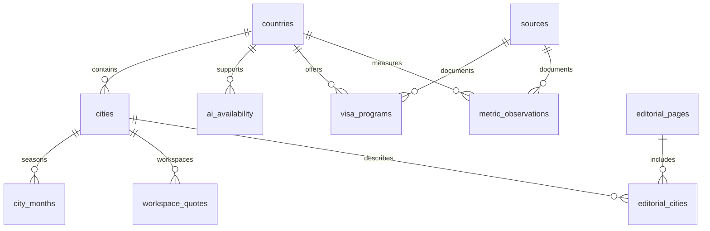

# 字段字典
所有数据库职责由 D1 承担；Notion 只写普通文本。以下字段与实际迁移文件一致。
## 关系概览

## countries · 地区身份与目录范围

| 字段 | 类型 | 必填 / 主键 |
| --- | --- | --- |
| id | TEXT | 主键 |
| iso2 | TEXT | 可空 |
| name_zh | TEXT | 必填 |
| name_en | TEXT | 必填 |
| region | TEXT | 必填 |
| subregion | TEXT | 可空 |
| catalog_scope | TEXT | 必填 |
| currencies | TEXT | 必填 |
| timezones | TEXT | 必填 |
| catalog_source | TEXT | 必填 |
| checked_at | TEXT | 必填 |

## cities · 城市身份、编辑摘要与查询用成本基准

| 字段 | 类型 | 必填 / 主键 |
| --- | --- | --- |
| id | TEXT | 主键 |
| country_id | TEXT | 必填 |
| slug | TEXT | 必填 |
| name_zh | TEXT | 必填 |
| name_en | TEXT | 必填 |
| region | TEXT | 必填 |
| summary | TEXT | 必填 |
| caveat | TEXT | 必填 |
| budget_amount | REAL | 可空 |
| budget_currency | TEXT | 必填 |
| budget_basis | TEXT | 必填 |
| budget_source_id | TEXT | 可空 |
| budget_checked_at | TEXT | 可空 |
| publication_status | TEXT | 必填 |
| checked_at | TEXT | 可空 |
| photo_url | TEXT | 可空 |
| photo_credit | TEXT | 可空 |
| photo_source | TEXT | 可空 |
| featured_order | INTEGER | 必填 |

## sources · 来源、发布方与许可

| 字段 | 类型 | 必填 / 主键 |
| --- | --- | --- |
| id | TEXT | 主键 |
| url | TEXT | 必填 |
| publisher | TEXT | 必填 |
| title | TEXT | 必填 |
| kind | TEXT | 必填 |
| license | TEXT | 可空 |
| accessed_at | TEXT | 必填 |

## city_months · 逐月适住记录

| 字段 | 类型 | 必填 / 主键 |
| --- | --- | --- |
| city_id | TEXT | 主键 |
| month | INTEGER | 主键 |
| suitability | TEXT | 必填 |
| evidence_note | TEXT | 必填 |
| source_id | TEXT | 可空 |
| checked_at | TEXT | 可空 |

## metric_definitions · 指标单位与解释边界

| 字段 | 类型 | 必填 / 主键 |
| --- | --- | --- |
| id | TEXT | 主键 |
| label | TEXT | 必填 |
| unit | TEXT | 必填 |
| scope | TEXT | 必填 |

## metric_observations · 带年份的国家背景观测

| 字段 | 类型 | 必填 / 主键 |
| --- | --- | --- |
| id | TEXT | 主键 |
| country_id | TEXT | 必填 |
| metric_id | TEXT | 必填 |
| value | REAL | 可空 |
| year | INTEGER | 可空 |
| missing_reason | TEXT | 可空 |
| source_id | TEXT | 必填 |
| checked_at | TEXT | 必填 |

## ai_availability · 按产品记录官方地域名单

| 字段 | 类型 | 必填 / 主键 |
| --- | --- | --- |
| id | TEXT | 主键 |
| country_id | TEXT | 必填 |
| product | TEXT | 必填 |
| status | TEXT | 必填 |
| detail | TEXT | 必填 |
| source_id | TEXT | 必填 |
| checked_at | TEXT | 必填 |
| tested | INTEGER | 必填 |

## visa_programs · 已核读的签证/远程工作条件

| 字段 | 类型 | 必填 / 主键 |
| --- | --- | --- |
| id | TEXT | 主键 |
| country_id | TEXT | 必填 |
| name | TEXT | 必填 |
| kind | TEXT | 必填 |
| stay_text | TEXT | 必填 |
| amount | REAL | 可空 |
| currency | TEXT | 可空 |
| financial_basis | TEXT | 必填 |
| financial_rule | TEXT | 必填 |
| work_scope | TEXT | 必填 |
| passport_scope | TEXT | 必填 |
| restriction | TEXT | 必填 |
| verification | TEXT | 必填 |
| source_id | TEXT | 必填 |
| source_published_at | TEXT | 可空 |
| effective_at | TEXT | 可空 |
| checked_at | TEXT | 必填 |

## visa_observations · 独立保留第三方方案观测

| 字段 | 类型 | 必填 / 主键 |
| --- | --- | --- |
| id | TEXT | 主键 |
| country_id | TEXT | 必填 |
| provider | TEXT | 必填 |
| scheme | TEXT | 必填 |
| provider_status | TEXT | 可空 |
| payload | TEXT | 必填 |
| source_id | TEXT | 必填 |
| checked_at | TEXT | 必填 |

## workspace_quotes · 具体运营方的工位报价

| 字段 | 类型 | 必填 / 主键 |
| --- | --- | --- |
| id | TEXT | 主键 |
| country_id | TEXT | 必填 |
| city_id | TEXT | 可空 |
| place_label | TEXT | 必填 |
| operator | TEXT | 必填 |
| plan | TEXT | 必填 |
| amount | REAL | 必填 |
| currency | TEXT | 必填 |
| period | TEXT | 必填 |
| access_hours | TEXT | 必填 |
| network_claim | TEXT | 必填 |
| restriction | TEXT | 必填 |
| validity | TEXT | 必填 |
| source_id | TEXT | 必填 |
| checked_at | TEXT | 必填 |

## editorial_pages · 网页文章、比较主题与发布状态

| 字段 | 类型 | 必填 / 主键 |
| --- | --- | --- |
| id | TEXT | 主键 |
| slug | TEXT | 必填 |
| kind | TEXT | 必填 |
| title | TEXT | 必填 |
| summary | TEXT | 必填 |
| body_json | TEXT | 必填 |
| status | TEXT | 必填 |
| reviewed_at | TEXT | 可空 |
| updated_at | TEXT | 必填 |

## editorial_cities · 文章与城市的关系

| 字段 | 类型 | 必填 / 主键 |
| --- | --- | --- |
| page_id | TEXT | 主键 |
| city_id | TEXT | 主键 |
| position | INTEGER | 必填 |

## notion_links · 只用于首批迁移的原记录映射

| 字段 | 类型 | 必填 / 主键 |
| --- | --- | --- |
| page_id | TEXT | 主键 |
| entity_type | TEXT | 必填 |
| entity_id | TEXT | 必填 |
| last_edited_at | TEXT | 可空 |
| payload_hash | TEXT | 必填 |

## import_runs · 输入哈希与导入审计

| 字段 | 类型 | 必填 / 主键 |
| --- | --- | --- |
| id | TEXT | 主键 |
| started_at | TEXT | 必填 |
| input_hashes | TEXT | 必填 |
| summary | TEXT | 必填 |

## content_documents · 指定 Notion 普通文本的候选版本

| 字段 | 类型 | 必填 / 主键 |
| --- | --- | --- |
| id | TEXT | 主键 |
| source_page_id | TEXT | 必填 |
| revision_hash | TEXT | 必填 |
| title | TEXT | 必填 |
| body_markdown | TEXT | 必填 |
| imported_at | TEXT | 必填 |
| status | TEXT | 必填 |

## 留待后续实证的数据

城市 IANA 时区已随真实坐标单列保存；街区与具体住宿报价仍须单独采集。预算下一阶段建立 cost_estimates，明确人数、租期、房型、月份、低/高估计与房费、餐饮、交通、工位等包含项；当前单点估算只能做初筛。签证资格下一阶段按护照、居住地、申请领区、工作类别分别建条件记录，未经官方核对不可补成 true。现有演示没有用空表、虚构金额或国家平均值冒充这些信息。

## 排行模型新增字段（0002_rankings.sql）

| 表 | 主键 | 字段与消费程序 |
| --- | --- | --- |
| score_models | id | label、default_weights JSON、formula_note、max_score、snapshot_date；解释排行公式和版本 |
| city_scores | city_id | model_id；safety/cost/climate/life/internet/community（0–10，可空）；original_metric_score（0–10.5）；community_label、why_short、evidence_level、checked_at、source_id；首页、比较与指标详情 |
| city_entry_conditions | city_id + passport | entry_type固定枚举、label、detail、evidence_level、checked_at、source_id；护照筛选与标签；不进入分数 |
| city_locations | city_id | latitude、longitude、timezone（IANA）、geonames_id、match_method、source_id、checked_at；真实地图位置与气象查询 |
| city_climate_months | city_id + month | mean_c、high_c、rain_mm（可空）、sample_days、period_start、period_end、model、source_id、checked_at；温度列、月份带、避寒筛选与详情表 |

`climate` 是旧环境分，`mean_c` 才是独立温度；`high_c` 是逐日日最高温的平均，不是历史极值；`rain_mm` 是三年同月总雨量的平均。`sample_days` 表示温度、高温、雨量均有效的天数。缺失值不写0；雨量0与社区0均为真实有效值。

索引覆盖原分降序、护照/类型、月份/均温。城市、评分模型与来源均有外键。当前排名在浏览器内对348城计算，无需为每次拖动做数据库扫描；正式页面在边缘缓存，后续增长再根据实测决定分页API或物化视图。
