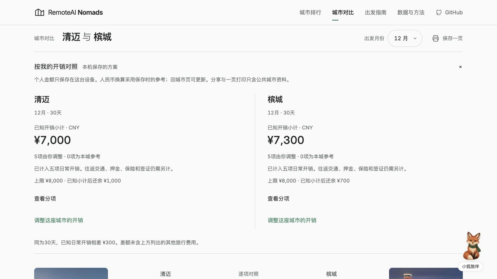

# 五种数字游民的连续任务走查

这是模拟角色评审，操作发生在真实浏览器中。分数是对已观察任务的独立判断，不是真实用户研究、满意度调查，也不证明住宿、街区安全、场所网络或个人入境资格已实地验证。

## 固定任务与评分

五种角色从 GitHub README 进入项目网站，完成找城、调整偏好、查看预算和月份、核对工作与停留资料、比较两城，再保存或分享选择及第一周清单。首次出境者用清迈与槟城；女性独行者用清迈与清莱；会议较多的工程师用里斯本与波尔图；国内低预算者在手机上先看大理，再看成都与厦门；重视社群者用清迈与乌布。

每轮采用相同标准：入口理解 15 分，选城与偏好 20 分，预算及季节判断 25 分，工作、入境与来源 20 分，完成、恢复及可访问性 20 分。关键任务最终未完成时最高 90 分；缺失或不同口径的数据造成误导时最高 80 分。未观察的步骤不能按通过计分。只有五位均超过 95 分，且没有未解决的任务阻断或数据误导，才算达到本次模拟评审目标。首次失败经重试恢复的步骤仍保留过程和扣分。

共启动九轮，其中八轮完成了五位角色的完整走查，共40次完整旅程。第八轮遇到并行发布后中止，不计完整轮或旅程。第九轮在迁移后的冻结正式版本重新走查，五位均超过95分。第一轮从正式站开始。修复中的轮次使用同一 Worker 代码和审核后的只读公开数据库，按角色分配独立来源端口，隔离比较、收藏和个人计划。第六轮起在正式发布后重新走查。各轮绑定代码与公开数据库摘要；测试浏览器或原生打印受限与产品缺陷分开记录。

## 逐轮记录

评分与修改随实际走查结果追加。完整截图、路径、输入与断言保存在维护者本机 `.data/persona-e2e-20261019/`，不把源码推断或测试通过率冒充角色得分。

| 轮次 | 首次出境 | 女性独行 | 远程会议 | 国内预算 | 游民社群 | 环境与结论 |
| --- | ---: | ---: | ---: | ---: | ---: | --- |
| 1 | 84 | 80 | 90 | 80 | 80 | 正式站基线，尚未达标 |
| 2 | 93 | 94 | 80 | 80 | 96 | 本地副本；外币单位复核退回，未达标 |
| 3 | 95 | 96 | 99 | 95 | 97 | 本地副本；仍有角色未超过95分 |
| 4 | 99 | 96 | 100 | 97 | 99 | 本地副本；首次五位均超过95分 |
| 5 | 100 | 96 | 100 | 97 | 99 | 本地副本；保留手机按钮与资料缺口扣分 |
| 6 | 98 | 94 | 96 | 98 | 98 | 正式站；独行角色分享受阻，再次未达标 |
| 7 | 99 | 95 | 99 | 97 | 98 | 正式站；保留首次操作需重试的扣分，独行角色更正为95分 |
| 8 | — | 中止 | — | — | — | 并行域名迁移导致版本改变；仅25步观察，不计完整轮或旅程 |
| 9 | 99 | 96 | 100 | 98 | 98 | 迁移后冻结的正式站；五位均超过95分 |

第一轮前三位都复现了月份跨页丢失和城市个人计划刷新丢失。独行角色发现：清迈的 OSM 场所密度分与清莱的历史社区标签分在对比页直接标出胜负，来源不同却没有就近说明。这个问题触发了误导上限。数据缺口继续保留，未补成零分。

第二轮角色复查已确认月份与个人计划可继续使用。当时仍未达标。独立技术复核又发现：美元计划刷新后输入前缀仍写CNY，网址后退时月份也可与画面分离。会议角色和国内角色分别独立复现单位冲突，按既定误导上限把此前97、95分调整为80；原始分与更正理由保留在各自记录中。

第三轮修复这些恢复边界，保留外币原报价金额与币种，避免汇率更新改掉用户报价；参考缺项与主动清空分别处理。回到排行会保留完整偏好。恢复后的报价摘要按当前个人金额更新。

第三轮另由独立技术复核发现未完成数字输入切币种时可误存为空、快捷搜索进城可恢复旧月份。前者由维护者在真实浏览器复现；两项均纳入第四轮修复。未走到该分支的角色记录不冒充已验收。

第四轮验证精确人民币参考预算、月份与原推荐标签分开选择，以及个人上限和已知小计的余额。余额不计作完整旅行可负担结论，费用缺项继续显式列出。排行换算采用2026-10-16的[欧洲央行参考汇率](https://www.ecb.europa.eu/stats/policy_and_exchange_rates/euro_reference_exchange_rates/html/index.en.html)，不作交易报价。

第四轮冻结版本通过281项检查。独立复核还发现并关闭了助手月份筛选与应用链接、人民币上下文标记、日期专题隐藏筛选的语义差异。日期专题现在会明确勾选有效限制，取消时退出专题条件；官方暂勿前往排除规则仍始终生效。第四轮起代码摘要也覆盖agent目录，前三轮未修改该目录。

第五轮加入本机个人方案对照：已知小计、实际停留天数、月份、分项来源与缺项分别显示；同月份同天数且五项完整才计算差额，不把差额当完整旅行成本。人民币采用保存时的换算快照。分享弹窗始终显示可读取的链接，剪贴板不可用时可手动复制或打开验证。个人报价不进入链接；打印样式隐藏个人区。维护者已用真实浏览器的打印媒体模式确认隐藏，未导出或验收原生PDF文件。

第五轮手机角色发现分享弹窗“完成”按钮高度37px，按恢复与可访问性扣1分。第六轮候选版本把它提高到44px；第五轮记录不回改。个人对照已解决后，国内预算角色仍为当前行情样本不足保留2分，独行角色为清莱缺价及评分原始来源保留4分。

## 补充核验入口

短期入境入口分别指向[泰国驻华使馆的中国护照免签说明](https://thaiembbeij.org/th/news/updateofvisaexemption/)、[马来西亚移民局的中马互免签问答](https://www.imi.gov.my/index.php/en/https-www-imi-gov-my-index-php-f-a-q-malaysia-china-visa-exemption-agreement/)和[印度尼西亚移民部门的签证目录](https://bontang.imigrasi.go.id/layanan-publik/kategori/wna/sub/daftar-visa-indonesia)。泰国说明正文已核读；其余按官方入口和分类核对，不冒充完成所有国籍与工作资格审查。核对日2026-10-19。

里斯本补充[Second Home场地页](https://secondhome.io/coworking-space-lisbon/)及[运营方FAQ](https://secondhome.io/faqs/)作为具体工作日核验线索，保留日票与会员规则的区别。官网列出设施不代表每次都能预约到，未做现场网络或会议质量实测。核读日2026-10-19。

上线前定向复测在390×844窗口确认“完成”与“打开这个视角”均为44px高，弹窗无横向溢出，关闭后焦点回到分享入口。最终候选通过286项检查、README同步检查与构建；公开页面快照通过发布数据边界检查。第六轮正式结果已追加，未达标的分享步骤继续修复。

## 正式版本与补充问答

PR #16已合并到 `68230beda6d3e14e8d6d6d76f5ab42a2eefb7e6b`，[主分支检查](https://github.com/cubxxw/RemoteAI-Nomads/actions/runs/39210896335)通过。部署身份为 `nomads-9a93df45150b769d`，Worker版本 `adf93671-932b-4256-993a-bbc0b74738b3`。正式站健康检查返回350座城市，16个关键资源与候选文件摘要一致。人民币筛选、空的服务端个人方案区、国家侧栏及城市上限入口均做过发布后核对。

五位正式站走查按顺序进行，避免共享浏览器中的比较槽与收藏互相干扰；各角色通过界面重设自己的条件，不在后台改浏览器存储。手机使用390×844的浏览器视口模拟，未作为真实手机硬件测试。

维护者另外在第六轮正式版本上发起了一次真实助手请求。回答识别8000CNY与11月，查询到24.79°C历史均温、54.33mm月降水，说明网络10/10为旧评分、不能代替房间测速；来源面板可展开。界面记录5次查询、26.1秒，回答保存后仍可读取。这是单条补充验证，不作为五角色得分或通用模型准确率。

首次出境角色在正式站保留2分恢复摩擦：初始与恢复阶段暂时显示默认状态，早期分享点击曾需重按。稳定后报价、上限、月份、会议与收藏均恢复。无查询首页HTML和资源检查均为新结构，不能据此把这段现象直接归因为旧部署；机制尚未隔离。

会议角色正式站为96分，保留一次明确加载失败：从两城对比回排行后，页面停留在默认235城，并提示“实时排序暂时未载入”。按提示刷新一次，欧洲、11月、网络权重及分享均恢复，未观察到永久数据丢失。该次扣3分；个人方案恢复时的默认画面过渡另扣1分。维护者随后在独立浏览器环境复查两次同路径，未复现持续失败，捕获的脚本响应为200或304，无页面异常；第二次早期分享点击仍需在恢复后重按。原失败没有可用应用栈，现有证据不能区分模块请求失败与初始化异常，不把后续成功写成已修复。

独行角色本轮降到94分。已恢复原偏好的排行上，鼠标和键盘激活分享均未出现弹窗，最终通过地址栏网址在新标签继续，原方案、收藏及清单均可恢复。分享摩擦扣2分，加上原资料缺口4分，使第六轮不能达标。走查期间另有一次未归因的导航异常；独占浏览器重新走查后未再发生，保留为可能的工具焦点干扰，没有计作产品缺陷。

独立复核对真实分享处理器做隔离调用，确认它先等待剪贴板完成，再显示弹窗。剪贴板持续待决时，手动复制和打开链接的入口也无法出现；这重现了一种确定的阻塞路径，不能证明本次浏览器失败只有这个原因。新增9项回归检查在旧代码上出现6项预期失败、3项通过，涵盖弹窗、准备状态、重复激活和异步恢复边界。

后续修复候选改为先显示链接，再尝试自动复制；入口在处理器准备好后才可点击，旧的复制回调不能覆盖新弹窗。9项回归检查现已通过，另补两项异步关闭检查；在内存副本中移除对应防护时，这两项会准确失败，真实源码11项全通过，完整检查为297项通过。本地真实浏览器验证了鼠标、键盘及关闭后的焦点恢复；受控阻断模块请求时明确显示暂不可用，解除阻断并刷新后恢复。新增本机异常记录便于继续定位加载问题，这些验证不等于查明第六轮原始故障的根因。候选通过构建与README同步检查，发布后将用第七轮重新评分。

## 第七轮正式回归

分享修复的[PR #17](https://github.com/cubxxw/RemoteAI-Nomads/pull/17)已合并到 `679d8e0a4908dbabe44efe3b688b859d22a19bfe`，[主分支检查](https://github.com/cubxxw/RemoteAI-Nomads/actions/runs/39220431538)通过297项检查。发布身份为 `nomads-11015670f63b38fe`，Worker版本 `70d4411b-a8ba-42e3-8c6d-571fbf6886cf`。健康检查正常，17个正式资源与本次构建逐字节一致；服务端分享准备状态、人民币条件及公开比较区也已核对。代码审查没有提出可操作问题，图片按审查工具规则排除，另由维护者目视检查。

第七轮继续使用相同任务与评分标准，先复测第六轮降到94分的独行角色，再依次走查其余角色。各角色从GitHub主分支的README重新进入正式站，全部浏览器操作串行；工具故障、首次失败、恢复结果与未验范围分别记录。

第七轮独行角色最初报96分，独立复核发现首次展开个人对照无效果、键盘重试才展开，却没有像其他角色一样扣分。按统一标准更正为95分，原96分与逐步证据保留。会议角色首次返回排行后分享需重按，扣1分；国内角色的首次国内筛选未保留，社群角色的首次搜索仍显示旧城，分别扣1分。稳定后各自任务均完成，没有把重试成功抹成首次成功。

本轮后半段Chrome输入工具反复超时，未算作产品缺陷。会议、国内、社群三位由维护者在内置浏览器完整操作，再由各角色独立核读本轮界面记录与截图评分。国内角色最初8张图实际为390×219，不能证明手机排版；补做真正390×844的界面验证，确认无横向溢出，分享两个入口均为44px。操作记录中误标的中间步骤不计成功，以实际新标签页及补测为准。

第八轮候选针对已证实的准备边界：先恢复本机方案与清单、绑定操作、更新画面，再开放控件；准备期间有可读提示。排行失败时仍能进入公共城市资料；清单与个人区载入失败明确提示刷新。浏览器拒绝保存清单时仍可当页勾选，同时说明刷新可能丢失。受控检查证明这些边界存在，不能据此断言已查明第七轮每一次首击失败的原因；有保存方案的个人区初始展开实验与正常绑定后国内筛选实验也作为反证保留。

候选通过313项检查；独立复核发现空结果恢复按钮遗漏，新增检查先准确失败，再纳入同一准备与失败保护。维护者在真实浏览器中阻断三个入口模块并解除阻断，确认失败提示与恢复后的操作；本地预览曾未重启而仍用旧服务端模板，那两条中间验证未计通过，重启后重新验收。正式发布后才开始第八轮评分。

第八轮修复经[PR #19](https://github.com/cubxxw/RemoteAI-Nomads/pull/19)合并，主分支474e054的检查通过。发布为 `nomads-23a200c74d2dab8d`、Worker `e236b56e-7c7f-4fda-a15a-109d54b8947c`，18个资源与本机候选逐字节一致。独行角色开始了25步观察，个人对照首次鼠标收起与键盘重开均有即时反馈；返回首页后的第一次分享仍未出现弹窗，原始HTML缺少新保护，重试才恢复。

此时另一项已获维护者授权的域名迁移正在兼容发布，线上Worker与发布标识随后改变。首页在不同时间与节点得到的新旧HTML不能直接认定为缓存实现串版，也不能作为原版本修复通过的证明。该次走查明确中止，保留25步原记录，未完成任务不补分，不计完整轮或完整旅程。迁移完成后，第九轮在新入口 `roamorrow.com/nomads/` 绑定最终版本重新走查五位。

## 第九轮最终验收

[准备边界修复 PR #19](https://github.com/cubxxw/RemoteAI-Nomads/pull/19)已随域名迁移进入最终正式版本。验收入口为 [Roamorrow 的数字游民目录](https://roamorrow.com/nomads/)，代码基线为 `1a4728bd8d855b5a964f44afb0385884468a0191`，[主分支检查](https://github.com/cubxxw/RemoteAI-Nomads/actions/runs/39236432656)通过341项检查。发布身份为 `nomads-f4378db5f5829cab`，Worker版本 `9d6d4713-844e-4ea5-9e4c-9b368bd237c9`。完整走查后再次核对，19个关键资源与候选文件逐字节一致，健康检查返回350座城市，普通入口与带条件入口均包含准备保护。资料总数与参与评分或推荐的城市数分别计算。

五位从GitHub主分支README重新进入网站，浏览器操作由维护者串行完成，各角色独立核读本轮原始界面记录和实际截图评分。只读接口、源码或自动检查不替代页面任务。首次出境角色35步，独行角色31步，会议角色36步，手机国内角色39步，社群角色34步。同一角色的定向补证属于原旅程，不另增加旅程数。

首次出境角色完成清迈7000元、槟城7300元的12月30天方案，验证缺项与跨月份、跨天数时暂停差额，恢复后相差300元。保留地图弹层标题部分被上沿裁切的1分扣减，地点列表仍可读。槟城工位三档限制、报价时效及AI服务地域范围已实际展开；马来西亚官方问答只确认入口及标题，正文没有读取成功。

独行角色完成清迈7650元、清莱7550元的11月30天方案，首次个人区收起和键盘重开均有反馈，返回排行后的首次分享直接显示链接，新页恢复偏好及本机记录。清莱缺少当前价格样本扣3分，旧指标原始来源不足扣1分，共96分。入境来源可查不代表已经确认个人工作资格。

会议角色验证美元原报价刷新后的单位，里斯本21天1624美元、波尔图1344美元；人民币对照使用保存时的汇率。冬夏会议时间分别显示09:00与10:00，场所规则和葡萄牙官方居留入口实际核读，分享与清单恢复完成。前11步使用390×844视口，后段恢复1280×720，并补查宽屏报价、夏令时和已加载地图；没有把早期尚未加载的底图判为永久失败。本轮固定任务未发现扣分项，评分100不代表所有城市或分支均已验证。

国内角色在390×844视口走完大理、成都与厦门。州级食品监测保留历史日期及公斤、升的单位，居民年度支出没有当成短租月预算。大理30天5100元、31天5270元，未完成的负号输入不会被误存或换币。成都与厦门完整方案相差620元；缺项、月份或天数不同均暂停差额。分享入口与完成按钮为44px高，Escape关闭后焦点回到入口；新页及清单刷新恢复。当前城市行情样本不足仍扣2分。

社群角色确认60是相对权重，六项合计145。清迈14处共享办公、948家咖啡馆与乌布3处共享办公、199家咖啡馆均来自所示5公里范围的OSM记录；地图实际加载和地点定位已完成。氛围分解释为场所密度，咖啡馆能否办公仍待确认。Outpost原文的会员活动、开放时间和通话间规则已核读，印尼官方页仅核对签证分类。清迈8700元、乌布9000元完整方案相差300元，缺项及口径不同均暂停差额。刷新瞬间的默认值过渡保留1分扣减，后续已恢复金额、上限、会议及收藏；系统剪贴板实际字节未验证再扣1分，共98分。

所有首次尝试和工具异常均保留。手机侧栏收起后使用旧定位信息、视口刚改变后的错位点击，以及输入目标保护拒绝的操作，都没有计为成功；只有读取当前界面后实际完成的步骤获得信用。第九轮没有用第七轮截图补任务，也没有用混版中止记录补分。完成八轮完整走查后，第九轮达到本次模拟门槛，后续仍需真实用户研究与出行前核验。

下图为第九轮冻结正式站的个人方案对照，使用两城各自填写的模拟报价，金额不代表当前房源行情。

